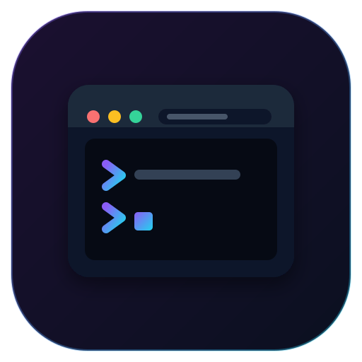

<p align="center">
  
</p>

# WebX11

Stream any GNU/Linux GUI application straight to a web browser, with low latency and
automatic window resizing.

No VNC, no noVNC, no websockify and no special client software: a `pip install`, one
command with the binary you want to run, and the app shows up in your browser.

## TL;DR

```bash
pip install git+https://github.com/lp1dev/WebX11.git
webx11 {any_binary}
```

That's it\*, your window is accessible on http://localhost:8080.

*You will also need Xvfb in your $PATH.

## Overview

WebX11 creates a virtual X11 display with `Xvfb`, captures what your application draws,
and streams it to the browser over a **WebSocket**. Only the regions of the screen that
actually change are sent (small tiles), lossless for sharp text and lossy for large
areas, so bandwidth stays low and text stays crisp. Input (mouse, keyboard, scroll,
clipboard) is sent back to X11.

You're a sysadmin and need to open a GUI app on a remote server on a whim? Need to
expose a GUI tool for a lab? WebX11 has you covered.

## Performance

It is fast. On a **regular VPS connection** you can comfortably watch **30fps video**,
and on **good local-network conditions you can reach 60fps and beyond**. Latency is low
enough to use interactive apps (editors, browsers, terminals) naturally.

> **Note**: audio is out of scope. WebX11 streams the display only; there is **no sound
> support**, by design.

## Key features

- 🚀 **Low-latency WebSocket streaming** with tile-based dirty-region diffing
- 🔎 **Crisp text**: small changed regions are sent lossless (PNG), large ones as JPEG
- 📐 **Automatic window resizing** to match the browser viewport (`resize-x11`)
- 🎯 **Direct X11 integration**, no VNC or intermediary protocol
- ⌨️ **Full input**: mouse, scroll, international keyboards, text input and clipboard paste
- 🔌 **Simple HTTP API** to create, list, resize and close displays
- 📊 **Built-in stats overlay** (press `Ctrl`+`Alt`+`Shift`+`S` to toggle)
- 🧩 **Trivial to run**: `pip install`, then `webx11 <binary>`

## Requirements

- **Python** 3.8+
- **`Xvfb`** (virtual framebuffer X server) available on `PATH`

On Debian/Ubuntu: `sudo apt-get install xvfb`
On Alpine: `apk add xvfb`

## Installation

```bash
pip install git+https://github.com/lp1dev/WebX11.git
```

That is it: no optional extras, no certificate generation, no browser flags.

## Usage

Run it with the executable you want to expose:

```bash
webx11 xterm
# or any GUI binary
webx11 firefox
```

Then open your browser at:

```
http://localhost:8080
```

and the application is right there, interactive.

To expose several apps, or to start them on demand, use the HTTP API below.

### Ports

| Port | Purpose |
| --- | --- |
| `8080` | HTTP interface and API |
| `8081` | WebSocket stream |

The viewer page served on `8080` connects to the WebSocket on `8081` automatically.
Behind a reverse proxy, serve the UI and forward `/ws/<id>` to the WebSocket server
(see [Security](#security-considerations)).

## How it works

1. WebX11 spawns a virtual X display with `Xvfb` (its framebuffer lives in `/dev/shm`
   for fast, zero-copy capture).
2. It captures the window content and splits each change into tiles.
3. Changed tiles are encoded (PNG when small/lossless, JPEG when large) and streamed to
   the browser over the WebSocket.
4. Input events from the browser are replayed into X11.
5. The X display is resized to follow the browser viewport.

## Configuration

WebX11 ships with sane defaults. To override them, drop a `settings.json` in the
directory you run `webx11` from (or pass your own):

```json
{
  "resize_mode": "resize-x11",
  "image_quality": 80,
  "image_format": "JPEG",
  "dpi": 300,
  "x_dpi": 96,
  "max_width": 3840,
  "max_height": 2160,
  "max_fps": 30,
  "lossless_max_area": 160000,
  "lossless_refresh_ms": 400,
  "can_start_executables": false,
  "host": "127.0.0.1",
  "cors_unsafe_allow_all": false
}
```

> **Note**: keep `max_width` / `max_height` larger than the biggest size your window
> will ever be resized to. With `resize-x11` the framebuffer is large but only the
> visible window area is captured, so high values do not hurt performance.

### Configuration options

| Option | Type | Description |
|--------|------|-------------|
| `resize_mode` | string | `"resize-x11"` resizes the X display to the viewport, `"none"` disables it, `"stretch"` scales the image client-side |
| `image_quality` | number | JPEG quality (10-100) for large changed regions |
| `image_format` | string | Lossy format for large regions (`JPEG` by default; anything Pillow supports) |
| `dpi` | number | Display DPI used for capture (100-1500) |
| `x_dpi` | number | DPI announced by Xvfb to X clients, i.e. font scaling (48-384) |
| `max_width` | number | Maximum framebuffer width in pixels |
| `max_height` | number | Maximum framebuffer height in pixels |
| `max_fps` | number | Maximum frames per second (1-120) |
| `lossless_max_area` | number | Changed regions up to this many pixels are sent lossless (PNG) |
| `lossless_refresh_ms` | number | Re-send JPEG regions as PNG once the screen has been idle this long (ms), `0` disables |
| `can_start_executables` | boolean | Allow starting executables via the API (security consideration) |
| `host` | string | Interface to bind (`127.0.0.1` by default; `0.0.0.0` to expose) |
| `cors_unsafe_allow_all` | boolean | Allow any origin (`*`) in CORS. Leave off unless you know you need it |

## HTTP API reference

### `GET /displays`
List active displays.

```json
[{ "id": 1, "display": ":2", "width": 1280, "height": 720, "executable": "xterm", "name": "Window 1" }]
```

### `POST /display`
Create a new display.

> Create a display **larger** than the biggest size it will be resized to; the first
> automatic resize shrinks it. Starting large is fine.

```json
// request
{ "width": 1920, "height": 1080 }
// response
{ "message": "OK", "display": 1 }
```

### `GET /display/{id}`
Return the interactive viewer page for a display.

### `POST /display/{id}/run`
Start an executable on a display (requires `can_start_executables: true`).

```json
// request
{ "executable": "firefox" }
// response
{ "message": "OK", "display": 1, "process": 12345 }
```

### `POST /resize/{display_id}/{width}/{height}`
Manually resize a display.

### `DELETE /display/{id}`
Close a display.

### `GET /settings.json`
Return the client-facing settings used by the viewer.

## Keyboard

- `Ctrl`+`Alt`+`Shift`+`S` — toggle the stats overlay (FPS, bandwidth, draw time)
- International layouts work automatically; clipboard paste is supported

## Performance tips

1. Lower `image_quality` (60-80) on slow networks.
2. Reduce `max_fps` if CPU usage is high.
3. Raise `lossless_max_area` for text-heavy apps (sharper), lower it to save bandwidth.
4. Keep `resize-x11` on so the framebuffer matches the viewport.

## Security considerations

This is a small project. It has **no authentication** and the WebSocket/HTTP traffic is
**unencrypted**. Do **not** expose it directly to the internet.

- **Bind to localhost** by default (`host`); only set `0.0.0.0` behind a trusted front.
- **`can_start_executables`**: keep it `false` unless you explicitly need the `/run` API.
- **Encryption / auth**: put an HTTPS/WSS reverse proxy (nginx, Caddy…) in front, add
  authentication there, and forward `/ws/<id>` to the WebSocket server and the rest to
  the HTTP API.

## Troubleshooting

**Black screen or no frames**
- Make sure `max_width` / `max_height` are larger than the browser window.
- Check that `Xvfb` is installed and on `PATH`.
- Verify your executable actually launched on the display.

**Keyboard not working**
- Click the display area to focus it.
- Check the browser console for errors.

**High CPU usage**
- Lower `max_fps` and/or `image_quality`.
- Check whether several displays are running at once.

## Development

### Project structure

```
webx11/
├── server.py            # Entry point (the `webx11` command)
├── api_handler.py       # HTTP API
├── websockets.py        # WebSocket streaming server
├── display.py           # Display manager (Xvfb lifecycle, framebuffer)
├── window.py            # Per-window geometry and X interaction
├── capture.py           # Framebuffer capture + tile diffing/encoding
├── input_dispatch.py    # Client input -> X11
├── settings.py          # Configuration
├── settings.json        # Default settings
└── partials/
    └── display.html     # Client viewer
```

## License

[GNU GPLv3](./LICENSE.md)

## Acknowledgments

- Uses [python-xlib](https://github.com/python-xlib/python-xlib) for X11 integration
- Uses [Pillow](https://python-pillow.org/) for image encoding
- Inspired by the need for simple, clientless desktop streaming

## Support

For issues, questions or feature requests, please open an issue on GitHub.
